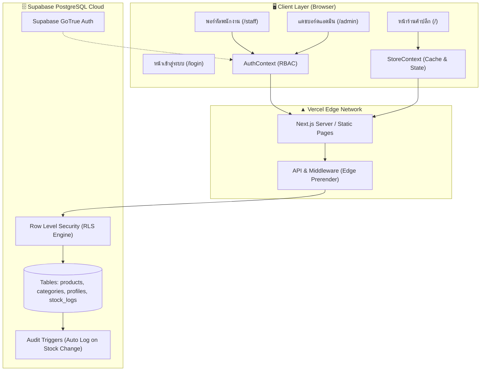

# 📘 คู่มือสถาปัตยกรรมระบบ ความปลอดภัย และการใช้งาน
## Retail Space — Retail Product Showcase & Dynamic Inventory

---

## 📑 สารบัญ
1. [ภาพรวมของระบบ (System Overview)](#1-ภาพรวมของระบบ-system-overview)
2. [สถาปัตยกรรมระบบ (System Architecture)](#2-สถาปัตยกรรมระบบ-system-architecture)
3. [ระบบความปลอดภัยและการควบคุมสิทธิ์ (Security & RBAC System)](#3-ระบบความปลอดภัยและการควบคุมสิทธิ์-security--rbac-system)
4. [คู่มือการใช้งานตามบทบาท (User Manual by Role)](#4-คู่มือการใช้งานตามบทบาท-user-manual-by-role)
   - [4.1 สำหรับลูกค้าทั่วไป (Customer)](#41-สำหรับลูกค้าทั่วไป-customer)
   - [4.2 สำหรับพนักงานคลังสินค้า (Staff)](#42-สำหรับพนักงานคลังสินค้า-staff)
   - [4.3 สำหรับผู้ดูแลระบบ (Admin)](#43-สำหรับผู้ดูแลระบบ-admin)
5. [การเชื่อมต่อฐานข้อมูลและการ Deploy (Supabase, GitHub, Vercel)](#5-การเชื่อมต่อฐานข้อมูลและการ-deploy)

---

## 1. ภาพรวมของระบบ (System Overview)

**Retail Space** เป็นเว็บแอปพลิเคชันร้านค้าปลีกสมัยใหม่ (Modern Retail Storefront & Dynamic Inventory) ที่ออกแบบมาเพื่อรองรับการแสดงสินค้าคุณภาพ การจัดการสต็อกสินค้าแบบเรียลไทม์ และระบบตะกร้าสอบถาม (Inquiry Cart) ที่เชื่อมต่อการขายสู่ LINE OA โดยไม่มีความซับซ้อนของ Payment Gateway พร้อมระบบหลังบ้านที่มีการแยกสิทธิ์อย่างเข้มงวด

### 🛠️ เทคโนโลยีที่ใช้ (Tech Stack)
- **Frontend Framework**: [Next.js 16](https://nextjs.org/) (App Router, Turbopack, React 19)
- **Language**: TypeScript 5 (Type-safe 100%)
- **Styling**: Tailwind CSS v4 (โมเดิร์น ดีไซน์มินิมอล โทนสี Stone/Neutral + สีทองอำพัน)
- **Database & Auth**: [Supabase](https://supabase.com/) (PostgreSQL 15+, Row Level Security, Triggers)
- **State Management**: React Context (`AuthContext`, `StoreContext`) พร้อม LocalStorage Dual-Mode
- **Icons**: Lucide React
- **Hosting & CI/CD**: [GitHub](https://github.com/palmkaka/watchara-fusion-society) + [Vercel](https://vercel.com/) Global Edge Network

---

## 2. สถาปัตยกรรมระบบ (System Architecture)

ระบบถูกออกแบบด้วยสถาปัตยกรรม **Decoupled Client-Server & Edge Architecture** แบ่งออกเป็น 3 เลเยอร์หลัก:



### องค์ประกอบสถาปัตยกรรม:
1. **Presentation Layer (Next.js App Router)**:
   - ใช้ระบบ Route Grouping แยกหน้าของแต่ละบทบาท:
     - `/` &rarr; หน้าร้านค้าปลีกที่โหลดเร็วและไม่มีองค์ประกอบหลังบ้าน
     - `/login` &rarr; หน้าเข้าสู่ระบบและสมัครสมาชิกตามเค้าโครงแบรนด์
     - `/staff` &rarr; พอร์ทัลจัดการสต็อกสำหรับพนักงานคลัง
     - `/admin` &rarr; ศูนย์ควบคุมจัดการสินค้า หมวดหมู่ และระบบหลังบ้าน
2. **State & Offline-Resilient Layer**:
   - `StoreContext`: จัดการข้อมูลสินค้า ตะกร้าสอบถาม และหมวดหมู่ มีระบบ **Dual-Mode**: หากยังไม่ได้เชื่อมต่อ Supabase ระบบจะทำงานผ่าน LocalStorage ทันทีอย่างไร้รอยต่อ และเมื่อใส่ API Keys ใน `.env.local` ระบบจะเชื่อมต่อฐานข้อมูล PostgreSQL อัตโนมัติ
   - `AuthContext`: เก็บสถานะการยืนยันตัวตน บทบาทผู้ใช้ (Role) และประวัติบัญชี
3. **Database & Audit Layer**:
   - PostgreSQL บน Supabase มี Trigger ฟังก์ชัน `log_product_stock_change()` คอยตรวจจับการเปลี่ยนแปลงจำนวนสต็อกสินค้าในตาราง `products` และบันทึกลงตาราง `stock_audit_logs` แบบอัตโนมัติ

---

## 3. ระบบความปลอดภัยและการควบคุมสิทธิ์ (Security & RBAC System)

ระบบความปลอดภัยถูกออกแบบตามหลักการ **Defense in Depth (การป้องกันหลายชั้น)** เพื่อไม่ให้ผู้ใช้สามารถข้ามสิทธิ์ได้:

```
Layer 1: UI Level (ซ่อนปุ่มและเมนูตามสิทธิ์)
    ↓
Layer 2: Client Route Guard (ตรวจสิทธิ์ในหน้า Page หากไม่ใช่สิทธิ์ที่อนุญาตจะบล็อกทันที)
    ↓
Layer 3: Network & Token Layer (JWT Session)
    ↓
Layer 4: Database Row Level Security (RLS) บน PostgreSQL
```

### 3.1 ระดับบทบาทผู้ใช้งาน (RBAC Roles)
ระบบแบ่งออกเป็น 3 บทบาทอย่างเด็ดขาด:

| สิทธิ์ (Role) | สิทธิ์การเข้าถึงหน้าเว็บ | สิ่งที่ทำได้ | สิ่งที่ถูกบล็อกเด็ดขาด |
| :--- | :--- | :--- | :--- |
| **ลูกค้า (Customer)** | เฉพาะหน้า `/` | ดูสินค้า, ค้นหา, กรองหมวดหมู่, ใส่ตะกร้า Inquiry Cart, ส่งแชท LINE | ห้ามเข้า `/staff` และ `/admin` เด็ดขาด |
| **พนักงาน (Staff)** | หน้า `/` และ `/staff` | ดูสต็อกคงเหลือ, ดูราคาทุน, ดูกำไรขั้นต้น, ดูโน้ตภายใน, ปรับสต็อกด่วน (+/-), ดูประวัติสต็อก | **ห้ามเข้า `/admin` เด็ดขาด**, ห้ามลบ/แก้ไขข้อมูลสินค้า, ห้ามจัดการหมวดหมู่ |
| **แอดมิน (Admin)** | ทุกหน้า (`/`, `/staff`, `/admin`) | เพิ่ม/แก้ไข/ลบ/ซ่อนสินค้า (Full CRUD), จัดการหมวดหมู่ไดนามิก, ดูและปรับสต็อกทั้งหมด | ไม่มีข้อจำกัด |

### 3.2 กลไกการบล็อกพนักงานไม่ให้เข้าหน้าแอดมิน (Staff-to-Admin Prevention)
1. **การซ่อนในส่วนแสดงผล (No UI Link)**:
   - ใน `Navbar.tsx` หากล็อกอินเป็น Staff ระบบจะแสดงปุ่มสีน้ำเงิน **"ระบบสต็อก (Staff)"** ซึ่งพาไปที่ `/staff` เท่านั้น จะไม่มีปุ่มหรือลิงก์ใด ๆ ไปที่ `/admin`
2. **การบล็อกระดับ Route Guard (Page Guard Protection)**:
   - ภายในโค้ด `src/app/admin/page.tsx` มีการตรวจสอบสิทธิ์:
     ```typescript
     if (!isAuthenticated || !isAdmin) {
       // หากเป็น Staff ระบบจะตัดเข้าหน้า Access Denied ทันที
       // พร้อมแจ้งเตือน "พนักงานไม่สามารถเข้าถึงหน้าแอดมินได้"
       // และมีปุ่มให้กดกลับไปที่ /staff เท่านั้น
     }
     ```
3. **การป้องกันระดับฐานข้อมูล (PostgreSQL Row Level Security - RLS)**:
   - ฟังก์ชันความปลอดภัยระดับฐานข้อมูล:
     ```sql
     create or replace function public.is_admin()
     returns boolean as $$
       select (public.current_user_role() = 'admin');
     $$ language plpgsql security definer;
     ```
   - นโยบาย RLS ของตาราง `products`: การ `INSERT`, `UPDATE`, `DELETE` ถูกผูกไว้กับ `is_admin()` เท่านั้น แม้พนักงานจะพยายามยิง API แก้ไขสินค้า ฐานข้อมูลจะปฏิเสธคำขอทันที

### 3.3 การปกป้องข้อมูลสำคัญ (Environment Secrets)
- ข้อมูลรหัสผ่านฐานข้อมูลและ Service Role Key จะไม่ถูกจัดเก็บไว้ในฝั่งไคลเอนต์
- ไฟล์ `.env.local` ถูกบันทึกลงใน `.gitignore` จึงไม่มีการอัปโหลดขึ้น GitHub ทำให้คีย์สำคัญปลอดภัยจากการรั่วไหล

---

## 4. คู่มือการใช้งานตามบทบาท (User Manual by Role)

### 4.1 สำหรับลูกค้าทั่วไป (Customer)
1. **การเข้าชมและค้นหาสินค้า**:
   - เข้าใช้งานผ่านหน้าแรก (`/`)
   - ใช้ช่องค้นหาตรง Hero Section เพื่อพิมพ์ชื่อสินค้า เช่น *"กระทะ"*, *"เครื่องครัว"*, หรือคลิกชิปคำค้นหายอดนิยม
   - คลิกแถบหมวดหมู่เพื่อกรองสินค้าเฉพาะกลุ่ม
2. **การสอบถามและสั่งซื้อผ่าน Inquiry Cart**:
   - คลิกปุ่ม **"สอบถามสินค้านี้"** ที่การ์ดสินค้าเพื่อเปิดดูรายละเอียดและรูปภาพขนาดใหญ่
   - กดปุ่ม **"เพิ่มลงตะกร้าสอบถาม"**
   - เมื่อเลือกสินค้าครบแล้ว กดที่ปุ่ม **"ตะกร้าสอบถาม"** มุมขวาบน
   - กรอกชื่อ, เบอร์โทร/LINE, และช่องทางที่สะดวก
   - กดปุ่ม **"คัดลอกข้อความสรุป & สั่งซื้อทาง LINE"** ระบบจะจัดรูปแบบรายการสินค้าให้อัตโนมัติ พร้อมส่งเปิด LINE Official `@retailspace` เพื่อปิดการขายได้ทันที
3. **การสมัครสมาชิก**:
   - ไปที่หน้าเข้าสู่ระบบ &rarr; กดลิงก์ **"สมัครสมาชิกก่อนใช้งาน"**
   - กรอกชื่อ-นามสกุล, อีเมล, เบอร์โทร, รหัสผ่าน &rarr; เลือกระดับ **"ลูกค้าทั่วไป"**
   - กดสมัครสมาชิก ระบบจะล็อกอินและแสดงชื่อบนหัวเว็บทันที

---

### 4.2 สำหรับพนักงานคลังสินค้า (Staff)
1. **การเข้าสู่ระบบ**:
   - เข้าที่หน้า `/login` &rarr; ระบุอีเมลและรหัสผ่านพนักงาน (หรือคลิกชิป Demo `Staff: staff@retailspace.com` รหัส `Retail123!`)
   - เมื่อล็อกอินสำเร็จ ระบบจะนำเข้าสู่หน้าระบบสต็อกพนักงาน (`/staff`) โดยอัตโนมัติ
2. **การตรวจสอบคลังสินค้า**:
   - แดชบอร์ดด้านบนจะสรุป:
     - สินค้าทั้งหมดในคลัง
     - สถานะระบบสต็อกเรียลไทม์
     - **สต็อกใกล้หมด (&le; 4 ชิ้น)**: สามารถคลิกที่การ์ดเพื่อกรองเฉพาะสินค้าที่ใกล้หมดได้ทันที
     - **สินค้าหมด (0 ชิ้น)**: แจ้งเตือนสินค้าที่ต้องสั่งผลิต/จัดซื้อเพิ่ม
3. **การตรวจสอบราคาทุนและกำไรขั้นต้น**:
   - ในตารางสินค้า พนักงานสามารถเห็นคอลัมน์ **"ราคาทุน"** (แถบสีส้มอ่อน) และ **"กำไรขั้นต้น (%)"** (สีเขียว)
   - หากสินค้ามีข้อความเตือนพิเศษ จะมีไอคอนเอกสารพร้อม **"โน้ตภายใน (Staff Notes)"** กำกับไว้
4. **การปรับจำนวนสต็อกด่วน (Quick Stock Stepper)**:
   - กดปุ่ม `+` หรือ `-` ในตารางเพื่อเพิ่ม/ลดสต็อกทีละ 1 ชิ้นได้ทันที
   - หรือคลิกที่ตัวเลขจำนวนสต็อก เพื่อเปิดหน้าต่างระบุตัวเลขและพิมพ์จำนวนสต็อกใหม่ที่ตรวจนับได้จริง
5. **การดูประวัติการปรับสต็อก (Stock Logs)**:
   - กดปุ่ม **"ประวัติสต็อก (Logs)"** เพื่อตรวจสอบว่าใครเป็นคนปรับสต็อก สินค้าอะไร ปรับจากเท่าใดเป็นเท่าใด พร้อมบันทึกเวลาที่แม่นยำ

---

### 4.3 สำหรับผู้ดูแลระบบ (Admin)
1. **การเข้าสู่แดชบอร์ดแอดมิน**:
   - ล็อกอินด้วยบัญชี Admin ที่ `/login` (หรือใช้ชิป Demo `Admin: admin@retailspace.com` รหัส `Retail123!`)
   - ระบบจะพาเข้าสู่ `/admin`
2. **การจัดการรายการสินค้า (Full CRUD)**:
   - **เพิ่มสินค้าใหม่**: กดปุ่มสีดำ `+ เพิ่มสินค้าใหม่` &rarr; กรอกชื่อ, คำอธิบาย, ราคาขาย, ราคาทุน, สต็อก, SKU, เลือกหมวดหมู่, ใส่ URL รูปภาพ, และโน้ตภายใน
   - **แก้ไขสินค้า**: คลิกไอคอนรูปดินสอที่แถวสินค้านั้น ๆ
   - **ลบสินค้า**: คลิกไอคอนรูปถังขยะสีแดง (ระบบจะถามยืนยันก่อนลบ)
   - **ซ่อน/แสดงสินค้า**: คลิกไอคอนรูปดวงตา (หากปิดตา สินค้าจะถูกซ่อนจากหน้าร้านค้าของลูกค้าทันที แต่ยังคงอยู่ในระบบสต็อกของพนักงานและแอดมิน)
3. **การจัดการหมวดหมู่อื่นๆ (Dynamic Categories)**:
   - กดปุ่มสีม่วง **"จัดการหมวดหมู่อื่นๆ"**
   - แอดมินสามารถสร้างหมวดหมู่ย่อยใหม่ เช่น *"อุปกรณ์แคมป์ปิ้ง"*, *"ของตกแต่งสวนสไตล์ญี่ปุ่น"*
   - หมวดหมู่เหล่านี้จะถูกจัดกลุ่มอยู่ใต้แท็บ **"อื่นๆ"** บนหน้าร้านของลูกค้าโดยอัตโนมัติ

---

## 5. การเชื่อมต่อฐานข้อมูลและการ Deploy

### 5.1 เชื่อมต่อ Supabase
1. สร้างโปรเจกต์บน [supabase.com](https://supabase.com)
2. ไปที่เมนู **SQL Editor** &rarr; วางสคริปต์จากไฟล์ `supabase/schema.sql` &rarr; กด **Run**
3. คัดลอก `Project URL` และ `anon key` จาก **Project Settings > API**
4. นำมาใส่ในไฟล์ `.env.local` เพื่อใช้งานบนเครื่อง และเตรียมนำไปใส่บน Vercel

### 5.2 การนำขึ้น Vercel
1. โค้ดปัจจุบันถูก Push ขึ้น GitHub Repository เรียบร้อยแล้ว:
   [https://github.com/palmkaka/watchara-fusion-society](https://github.com/palmkaka/watchara-fusion-society)
2. เข้า [vercel.com](https://vercel.com) &rarr; กด **Add New Project** &rarr; เลือก Repository `watchara-fusion-society`
3. ในหัวข้อ **Environment Variables** ให้ใส่:
   - `NEXT_PUBLIC_SUPABASE_URL` = (ค่า URL ของคุณ)
   - `NEXT_PUBLIC_SUPABASE_ANON_KEY` = (ค่า anon key ของคุณ)
4. กด **Deploy** ระบบจะสร้างเว็บไซต์พร้อมใช้งานจริงที่มีโดเมน HTTPS ทันทีครับ
